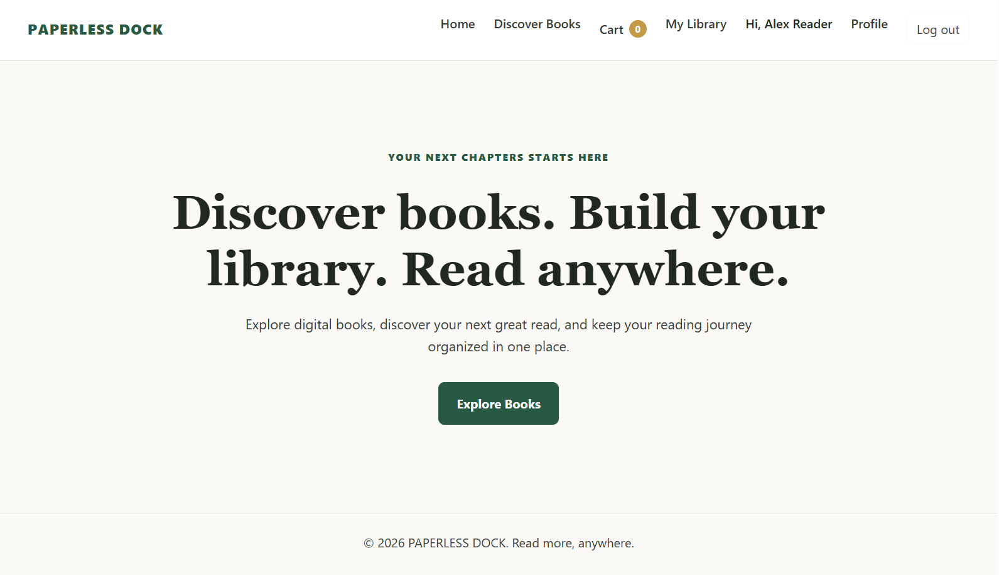
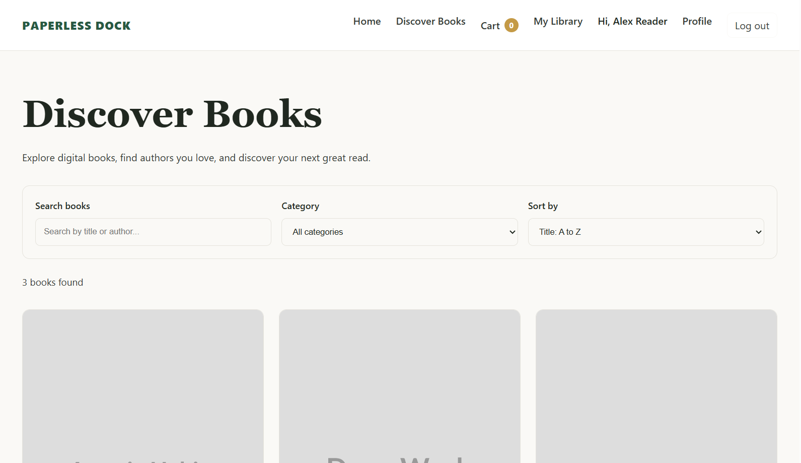
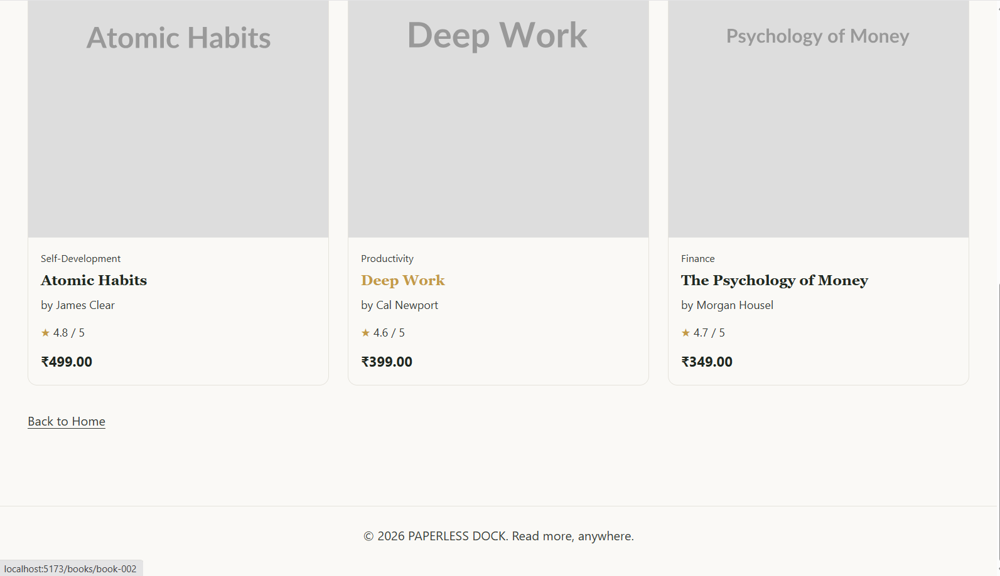
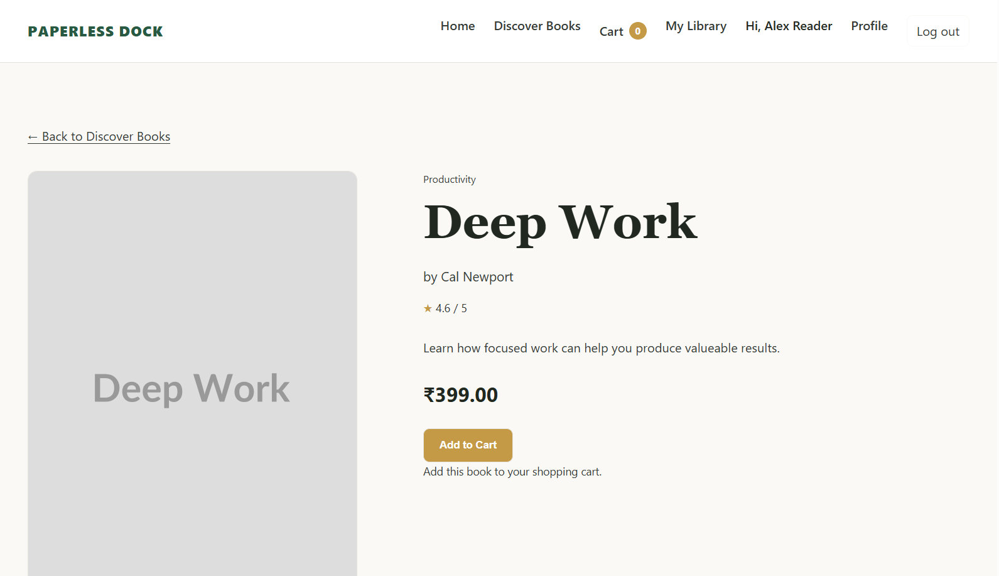
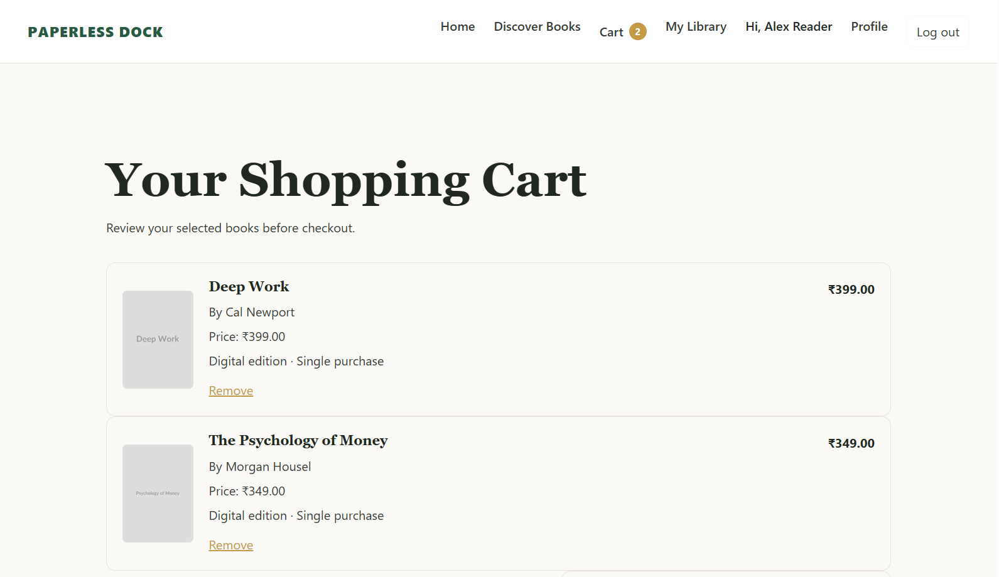
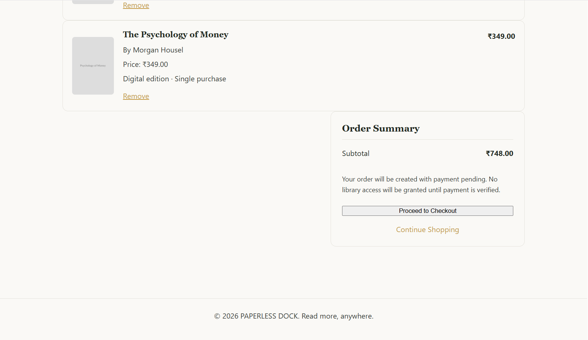
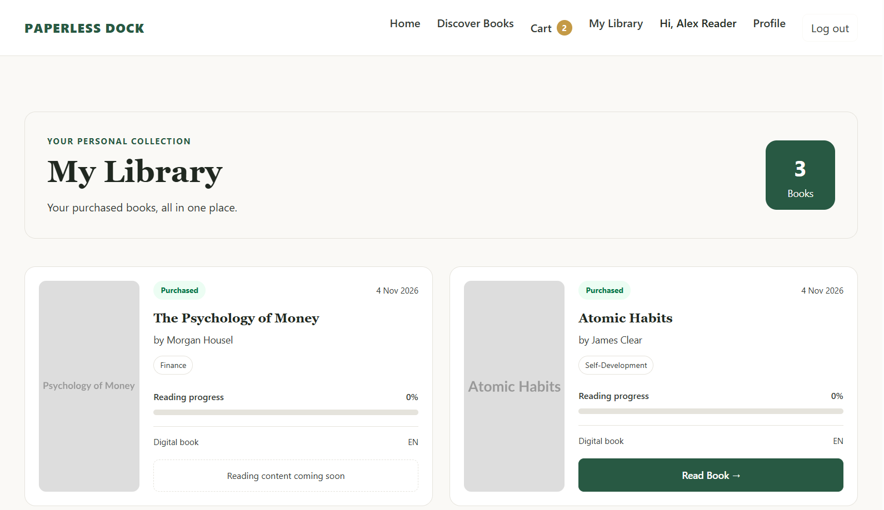
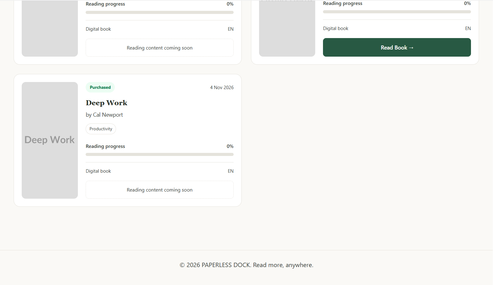
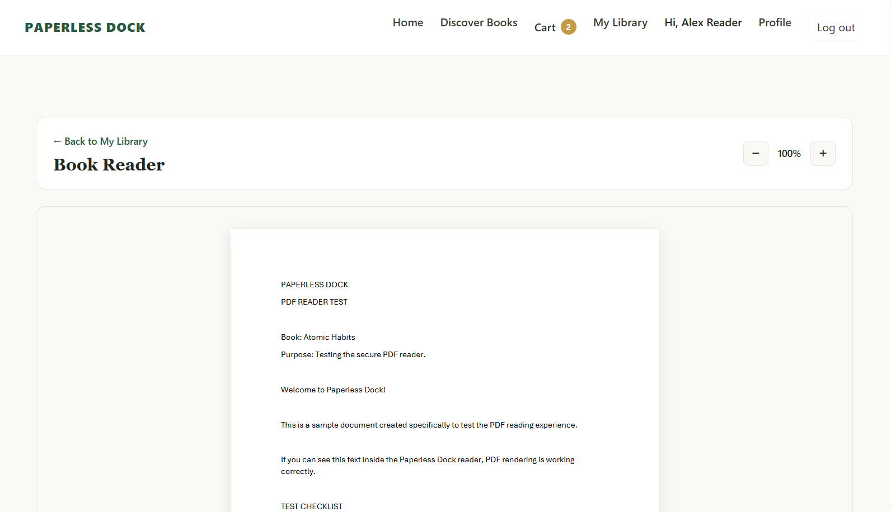
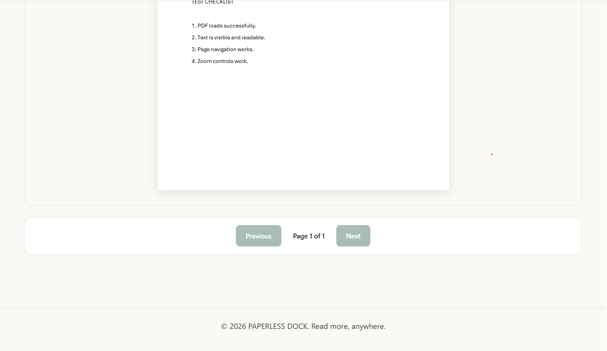

# Paperless Dock

## Discover, Own, and Read — Completely Paperless.

A full-stack digital bookstore and personal reading platform for discovering, purchasing, owning and reading digital books.

<p align="center">
  <a href="https://paperless-dock.pages.dev">
    <strong>Live Demo</strong>
  </a>
  &nbsp; · &nbsp;
  <a href="https://github.com/sumit-munda/paperless-dock">
    <strong>Source Code</strong>
  </a>
</p>

## Overview

Paperless Dock brings digital book discovery, e-commerce and personal reading together in one application.

Users can explore a book catalog, purchase digital books, access their personal library and read purchased books through an integrated PDF reader.

The application includes secure authentication, persistent shopping carts, payment processing, server-side payment verification, and protected access to privately stored PDF files.

<strong>Live Application:</strong> https://paperless-dock.pages.dev

The application uses a free-tier backend that may sleep after inactivity. The initial request can take some time while the server starts.

## Screenshots

### Homepage


### Books Catalog

Explore the catalog and browse available digital books.




### Book Details


### Shopping Cart



### My Library

Access purchased books from your personal library.




### PDF Reader

Read purchased digital books directly within the application.




## Features

### Book Discovery

- Browse books retrieved from the backend.
- Search books by relevant fields.
- Filter books by category and author.
- Sort books and explore detailed book information.

### Authentication & Authorization

- User registration and login.
- Persistent session-based authentication.
- Password hashing using bcrypt.
- PostgreSQL-backed session storage.
- Protected routes and role-based authorization.

### Shopping & Payments

- Add, update and remove cart items.
- Persistent shopping cart.
- Checkout and order creation.
- Razorpay payment integration.
- Server-side payment signature verification.
- Webhook-based payment confirmation with duplicate-event protection.
- Duplicate webhook event protection.

### Personal Library & Reading

- Access purchased books through a personal library.
- Verify authentication and book ownership before granting file access.
- Read digital books using an integrated PDF reader.
- Store private PDF files in Cloudflare R2.
- Serve protected PDF files without exposing permanent public file URLs.

## Technology Stack

| Category       | Technologies              |
| :------------- | :------------------------ |
| Language       | TypeScript                |
| Frontend       | React, Vite, React Router |
| Backend        | Node.js, Express.js       |
| Database & ORM | PostgreSQL, Prisma        |
| Authentication | Express Session, bcrypt   |
| Payments       | Razorpay                  |
| Object Storage | Cloudflare R2             |
| PDF Rendering  | React PDF, PDF.js         |
| Validation     | Zod                       |
| Testing        | Vitest, React Testing Library, Supertest |
| Frontend Hosting  | Cloudflare Pages          |
| Backend Hosting   | Render                    |

## Architecture

Paperless Dock uses a monorepo structure with separate frontend, backend, and shared-code workspaces.

### Production Deployment

```
                    Users
                      |
                      v
              Cloudflare Pages
                (React + Vite)
                      |
                      v
             Cloudflare Pages
                  Function
                /api/* Proxy
                      |
                      v
                  Render
               (Express API)
                      |
            +---------+---------+
            |                   |
            v                   v
       Neon PostgreSQL     Cloudflare R2
       (Database)          (Private PDFs)
            |
            v
       Prisma ORM

              Razorpay
          (Payment Gateway)

```

### Deployment Services

| Component       | Hosting/Service          |
| :------------- | :------------------------ |
| Frontend       | Cloudflare Pages          |
| API Backend    | Render                    |
| Database       | Neon PostgreSQL           |
| PDF Storage    | Cloudflare R2             |
| Payment Gateway| Razorpay                  |

The frontend communicates with the backend through a same-origin /api/* proxy.

## Getting Started

Follow these instructions to run Paperless Dock locally.

### Prerequisites

- Node.js
- npm
- PostgreSQL database
- Razorpay test account
- Cloudflare R2 bucket and API credentials

### 1. Clone the Repository

```
git clone https://github.com/sumit-munda/paperless-dock.git

cd paperless-dock
```

### 2. Install Dependencies

Run from the repository root:

```
npm install
```

### 3. Configure Environment Variables

Create local environment files using the provided examples.

<strong>Backend:</strong>

```
cp apps/api/.env.example apps/api/.env
```

<strong>Frontend:</strong>

```
cp apps/web/.env.example apps/web/.env
```

On Windows PowerShell, use:

```
Copy-Item apps/api/.env.example apps/api/.env
Copy-Item apps/web/.env.example apps/web/.env
```

<strong>Backend Environment</strong>

Configure apps/api/.env:

```
DATABASE_URL=YOUR_NEON_POOLED_CONNECTION_STRING
DIRECT_URL=YOUR_NEON_DIRECT_CONNECTION_STRING

SESSION_SECRET=YOUR_RANDOM_SESSION_SECRET

RAZORPAY_KEY_ID=YOUR_RAZORPAY_TEST_KEY_ID
RAZORPAY_KEY_SECRET=YOUR_RAZORPAY_TEST_KEY_SECRET
RAZORPAY_WEBHOOK_SECRET=YOUR_RAZORPAY_WEBHOOK_SECRET

R2_ENDPOINT=https://YOUR_ACCOUNT_ID.r2.cloudflarestorage.com
R2_BUCKET_NAME=paperless-dock-books
R2_ACCESS_KEY_ID=YOUR_R2_ACCESS_KEY_ID
R2_SECRET_ACCESS_KEY=YOUR_R2_SECRET_ACCESS_KEY
R2_REGION=auto
```

<strong>Frontend Environment</strong>

Configure apps/web/.env:

```
VITE_API_BASE_URL=http://localhost:3000
```

Use the appropriate local database, Razorpay Test Mode credentials, and Cloudflare R2 credentials.

<strong>Security:</strong> Never commit actual .env files, API keys, database credentials, session secrets, or storage credentials.

### 4. Database Setup

Make sure your PostgreSQL database is available and the connection strings are configured.

Run Prisma migrations from the API workspace:

```
cd apps/api

npx prisma migrate deploy
```

To populate the database with the available sample books:

```
npm run seed
```

Return to the repository root before starting the application.

### 5. Run the Application

Open two terminals from the repository root.

<strong>Terminal 1 — Backend:</strong>

```
npm run dev:api
```

<strong>Terminal 2 — Frontend:</strong>

```
npm run dev:web
```

The frontend and backend should now be available locally.

## Testing

Run workspace tests from the repository root:

```
npm test
```

Run backend integration tests separately:

```
cd apps/api

npm run test:integration
```

Integration tests use:

```
apps/api/.env.test
```

They require a separate PostgreSQL test database named:

```
paperless_dock_test
```

Do not use your production database for integration testing.

## Build

Build all workspaces from the repository root:

```
npm run build
```

The command builds the available workspaces using their respective build scripts.

## Testing Payments

Paperless Dock uses <strong>Razorpay Test Mode</strong> for demonstration purposes.

<strong>No real money is charged when using Razorpay Test Mode.</strong>

To explore the checkout process:

1. Add a book to your shopping cart.
2. Proceed to checkout.
3. Use the Razorpay test checkout interface.
4. For Netbanking, select any supported bank and use the simulated bank page's Success or Failure option.
5. For card and other payment scenarios, refer to Razorpay's official test credentials.

<strong>Official documentation:</strong> Razorpay Test Card and UPI Details

Do not use real payment credentials for testing.

## Project Structure

```
paperless-dock/
│
├── apps/
│   ├── web/                  # React frontend application
│   └── api/                  # Express backend API
│
├── packages/
│   └── shared/               # Shared application code
│
├── docs/
│   └── screenshots/          # Application screenshots
│
├── docker/                   # Docker configuration
│
├── package.json
└── README.md
```

## Future Improvements

Potential areas for further development include:

- Expanded book discovery and recommendation features.

- Improved reading experience and reader controls.

- Additional automated integration and end-to-end tests.

- Further performance and accessibility improvements.

### Author

#### Sumit Munda

GitHub: @sumit-munda

<p align="center">
  <strong>Paperless Dock</strong><br />
  Discover, Own, and Read — Completely Paperless.
</p>